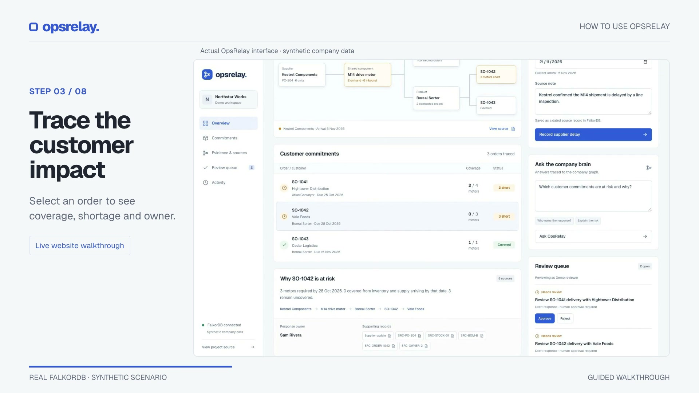
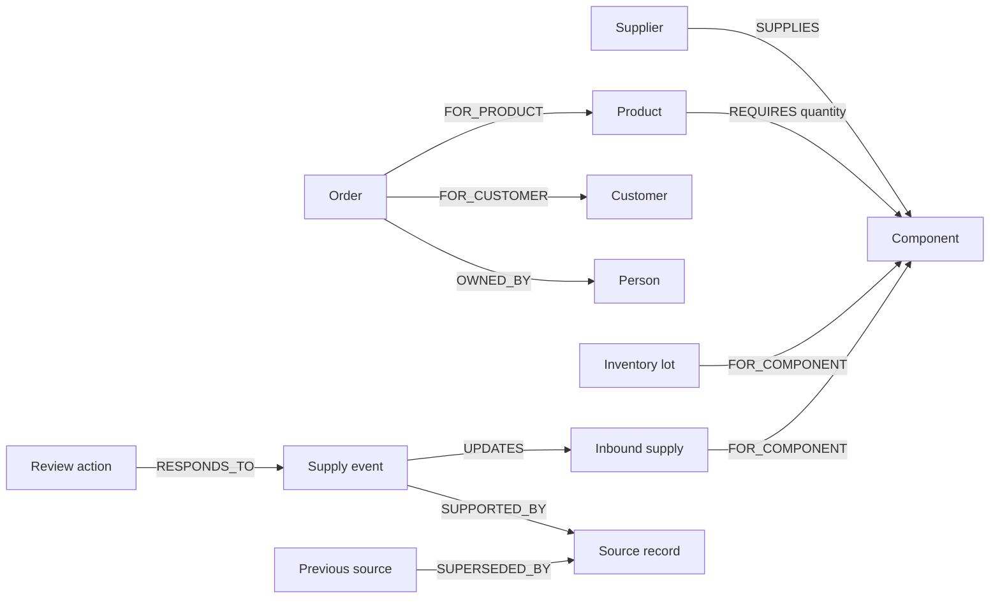

<div align="center">

# OpsRelay

### Know which customer commitments move when a supplier slips.

Trace supplier disruptions through your company graph, inspect the evidence, and review the next action.

[](https://github.com/Kartik2004sharma/OpsRelay/actions/workflows/verify.yml)


[**Explore live demo →**](https://opsrelay.onrender.com) · [Watch the walkthrough](#see-it-in-action) · [Run locally](#quick-start) · [Graph queries](docs/graph-queries.md)

Built for **Graph Hacks 2026 · Company Brain**

</div>

---

A delayed shipment rarely affects just one team. The same component can appear in several products, customer orders, and delivery promises. OpsRelay connects those relationships in **FalkorDB** and answers three questions:

**What is affected? Why? Who should respond?**

Record a supplier date change to recalculate coverage, trace affected commitments to their sources, and create proposals for human review. Record recovery to update the plan while preserving earlier evidence and decisions.

> **Try it without a password:** open the [live demo](https://opsrelay.onrender.com) and select **Explore live demo**. Each visitor gets an isolated synthetic workspace. Sessions last up to one hour; the free host may sleep or reset data earlier.

## See it in action

[](https://github.com/Kartik2004sharma/OpsRelay/raw/refs/heads/main/demo/opsrelay-walkthrough.mp4)

**[▶ Watch or download the 60-second walkthrough](https://github.com/Kartik2004sharma/OpsRelay/raw/refs/heads/main/demo/opsrelay-walkthrough.mp4)** · 1080p · On-screen instructions and music

| Time | Follow the workflow |
| --- | --- |
| 00:04 | Open an isolated demo without a password |
| 00:10 | Record a supplier delay and its source note |
| 00:16 | Trace affected orders, shortages, and owners |
| 00:22 | Inspect the underlying source record |
| 00:28 | Ask which commitments are at risk and why |
| 00:34 | Review and approve a proposed action |
| 00:40 | Record recovery and recalculate coverage |
| 00:46 | Inspect the retained activity and decisions |

The recording uses the working website and synthetic company data. Music attribution is in [media credits](demo/CREDITS.md); retain it when sharing the video. Video playback or download behavior depends on your browser.

## What you can do

| Capability | What it gives you |
| --- | --- |
| **Trace shared dependencies** | Follow supplier → component → product → customer order relationships returned from FalkorDB. |
| **Recalculate delivery risk** | Allocate available motors in due-date order and expose shortages after each arrival-date update. |
| **Explain the result** | Inspect graph paths, supporting records, response owners, and explicitly missing ownership. |
| **Keep knowledge current** | Distinguish the current supplier update from superseded plans without deleting earlier evidence. |
| **Review the response** | Approve or reject a proposal and retain the reviewer and decision. |
| **Record recovery** | Restore coverage, supersede outdated open proposals, and preserve completed reviews. |
| **Explore safely** | Use a separate temporary graph for each public demo, alongside a protected operator workspace. |

### A concrete disruption

The included company, **Northstar Works**, has two M14 motors in stock and six inbound from Kestrel Components, originally arriving on **20 October 2026**.

| Customer order | Motors required | Due date | Shortage if shipment arrives 5 November |
| --- | ---: | --- | ---: |
| SO-1041 · Hightower Distribution | 4 | 25 October | **2** |
| SO-1042 · Vale Foods | 3 | 28 October | **3** |
| SO-1043 · Cedar Logistics | 1 | 15 November | **0** |

Restore arrival to **20 October** and all three commitments become covered. Earlier updates, superseded sources, and recorded decisions remain inspectable.

## Why FalkorDB is central

The dependency map, impact list, evidence paths, activity, and review queue all depend on the graph. FalkorDB stores the relationships and operational state used to answer questions and record changes.



For example, this parameterized traversal identifies the customer commitments that share a component:

```cypher
MATCH (component:Component {id:$componentId})<-[requirement:REQUIRES]-(product:Product)
      <-[:FOR_PRODUCT]-(order:Order)-[:FOR_CUSTOMER]->(customer:Customer)
OPTIONAL MATCH (order)-[:OWNED_BY]->(person:Person)
RETURN order.id AS id, product.name AS product,
       order.quantity AS units, requirement.quantity AS motorsPerUnit,
       order.dueDate AS dueDate, customer.name AS customer,
       person.name AS owner
ORDER BY order.dueDate, order.id
```

The application then allocates stock in stable due-date and order-ID order. Inbound units are eligible only when they arrive by the order's due date. Read the [query contracts and lifecycle queries](docs/graph-queries.md) or inspect the [graph workflow](src/lib/ops.ts) and [allocation rules](src/lib/allocation.ts).

## Quick start

**Prerequisites:** Node.js **22.6+**, npm, Git, and Docker, or access to a managed FalkorDB instance.

```bash
git clone https://github.com/Kartik2004sharma/OpsRelay.git
cd OpsRelay
npm ci
```

Start a local graph database. The loopback bindings keep its ports on your machine:

```bash
docker run -d --name opsrelay-falkordb \
  -p 127.0.0.1:6379:6379 -p 127.0.0.1:3001:3000 \
  -v opsrelay-falkordb-data:/data \
  falkordb/falkordb@sha256:b0bdcac2cbaff989e77cb0610439b7a9289e86de033ccbbd4368b66fb680ae7a
```

Create private configuration, seed the synthetic company, and start the app:

```bash
npm run configure
npm run seed
npm run dev
```

Open **[localhost:3000](http://localhost:3000)** and select **Explore live demo**, or choose **Operator sign in** using the generated password in `.env.local`. The graph browser is at [localhost:3001](http://localhost:3001).

`npm run configure` creates `.env.local` with a random operator password and preserves any existing file. Keep it private. Seeding preserves an existing nonempty graph.

### Configuration

Use [`.env.example`](.env.example) as the reference. Both the application and the seed command load `.env.local`.

| Variable | Purpose |
| --- | --- |
| `FALKORDB_URL` | Database connection URL; local example: `falkor://127.0.0.1:6379`. |
| `FALKORDB_GRAPH` | Operator graph name; defaults to `opsrelay`. |
| `OPSRELAY_OPERATOR_NAME` | Display name of the protected operator identity. |
| `OPSRELAY_OPERATOR_PASSWORD` | Private operator password, at least 20 characters. |

For FalkorDB Cloud, replace `FALKORDB_URL` with the private connection URL supplied by the service before seeding. Production connections to a remote database require TLS through `falkors://` or `rediss://`.

<details>
<summary><strong>Reset the selected synthetic graph</strong></summary>

This removes updates and reviews from the graph selected by your configuration. Use it only for disposable data.

```bash
OPSRELAY_ALLOW_RESET=1 npm run seed -- --reset
```

</details>

## Architecture

```text
Browser · Next.js / React
        │ HttpOnly session cookie
        ▼
Route handlers · validated inputs · server-selected graph
        │ parameterized Cypher
        ▼
FalkorDB · relationships, sources, updates, review decisions
```

- `GET /api/ops` loads the workspace assigned to the current session.
- `POST /api/ops` records supplier changes and reviews, or returns deterministic graph analysis.
- Server-side sessions select the graph and reviewer identity. Public demo sessions cannot choose the operator graph.
- Supply updates use revision checks; completed reviews cannot be overwritten by a second review.

| Area | Source |
| --- | --- |
| Workspace interface | [`src/app/page.tsx`](src/app/page.tsx) |
| Graph reads and mutations | [`src/lib/ops.ts`](src/lib/ops.ts) |
| Allocation rules | [`src/lib/allocation.ts`](src/lib/allocation.ts) |
| Sessions and demo isolation | [`src/lib/auth.ts`](src/lib/auth.ts), [`src/lib/demo.ts`](src/lib/demo.ts) |
| Synthetic fixture | [`src/lib/seed-data.mjs`](src/lib/seed-data.mjs) |
| Browser verification | [`tests/browser/`](tests/browser/) |

## Development and verification

```bash
npm test                    # Allocation rules
npm run lint                # ESLint
npm run build               # Production build and framework type checking
npm run typecheck           # Standalone TypeScript check
npx playwright install chromium
npm run test:e2e            # Production build + browser tests against real FalkorDB
```

Browser checks cover the operator workflow, public demo isolation, recovery, review persistence, invalid inputs, session revocation, concurrency, and accessibility at desktop, tablet, and mobile sizes. They use a separate `opsrelay_e2e` graph and disposable demo graphs.

[GitHub Actions](.github/workflows/verify.yml) runs allocation tests, lint, the production dependency audit, a build, and Playwright against real FalkorDB. Visual comparisons run on macOS; Linux CI checks behavior and accessibility. The [verification record](docs/verification.md) distinguishes local, CI, and public deployment results.

## Deployment and current boundaries

The [live demo](https://opsrelay.onrender.com) runs the app and real FalkorDB together on Render's free plan. The included [Dockerfile](Dockerfile) serves the app on port `10000` and keeps FalkorDB on container loopback. Supply the operator configuration as private runtime environment variables.

- **Ephemeral hosting:** sleep, restart, or redeploy can reset demo changes and sessions. Use persistent FalkorDB hosting for lasting data.
- **Synthetic scenario:** all company records, people, orders, and documents are fictional.
- **Deterministic analysis:** supported questions are answered from graph queries and planning rules; this version has no LLM integration.
- **Human review:** approval records a decision inside OpsRelay. It does not send customer messages or update an ERP.
- **Focused planner:** allocation models one shared component; it is not a full manufacturing optimizer.
- **Access model:** one protected operator identity and isolated public demos; organizational SSO and enterprise role management are outside the current scope.

Read the [security boundaries](docs/SECURITY.md) before adapting the project for real company data.

## Documentation

- [Graph queries and return contracts](docs/graph-queries.md)
- [Security and hosting boundaries](docs/SECURITY.md)
- [Observed verification results](docs/verification.md)
- [Bounded repair loop](docs/REPAIR_LOOP.md)
- [Reproducible demo script](demo/DEMO_SCRIPT.md)
- [Hackathon submission checklist](docs/submission.md)
- [Media credits](demo/CREDITS.md)

## Contributing

Open an [issue](https://github.com/Kartik2004sharma/OpsRelay/issues) with the scenario, expected result, and observed behavior. For code changes, keep graph queries parameterized, use synthetic fixtures, and include verification for the behavior you change. Never include database credentials or private company records in an issue or pull request.

**AI assistance disclosure:** Codex assisted with planning, implementation, documentation, and QA. The participant is responsible for reviewing and understanding the submitted graph model, code, and evidence.
