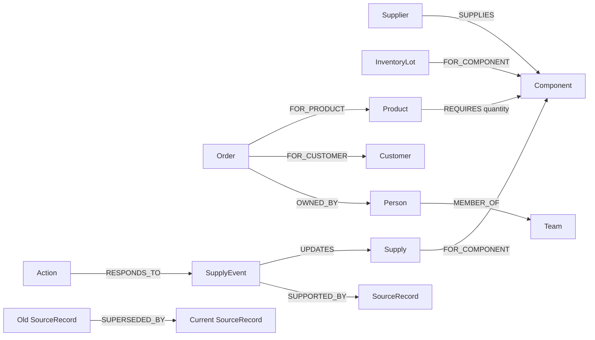

# OpsRelay — Supplier Disruption Brain

**Graph Hacks 2026 · Company Brain track**

[Live secured demo](https://opsrelay.onrender.com) · [Demo video](demo/opsrelay-demo.mp4) · [Verification](docs/verification.md)

The free demo requires the operator password, supplied privately by the project owner. It can take about a minute to wake and resets graph updates after restart.

OpsRelay answers an operations team's practical question: *if a supplier misses a date, which customer commitments break, why, and who should respond?* It follows relationships from supplier to component, product, order, customer, and owner in **FalkorDB**. A delay changes the graph, recalculates shortages, creates review tasks, and leaves the source trail visible. Recovery changes the answer without erasing the history.

The included company, people, orders, and documents are entirely synthetic. The analysis is deterministic and graph-grounded; the interface identifies it as such. There is no LLM or external company integration in this version.

## Working scenario

- Kestrel Components supplies six M14 motors, originally arriving **20 October 2026**. Two are already in stock.
- Two Atlas Conveyors for Hightower need four motors by **25 October**. Three Boreal Sorters for Vale Foods need three by **28 October**. A later Cedar Logistics order needs one.
- Record a delay to **5 November**. OpsRelay follows the graph and shows shortages of **two** and **three** motors for the first two orders; the later order remains covered.
- Inspect each order's graph path and source records. Ask who is responsible or why an order is at risk. Approve or reject the proposed customer response.
- Record recovery to **20 October**. All three commitments become covered again; open review tasks close, while prior updates and decisions remain in the graph.

## Run locally

Requires Node.js 22.6+ and Docker. FalkorDB is the primary data store; the app has no substitute data path.

```bash
docker run -d --name opsrelay-falkordb -p 6379:6379 -p 3001:3000 -v opsrelay-falkordb-data:/data falkordb/falkordb:latest
npm ci
npm run configure
npm run seed
npm run dev
```

Open [http://localhost:3000](http://localhost:3000). Sign in with `OPSRELAY_OPERATOR_PASSWORD` from the private, ignored `.env.local` file created by `npm run configure`. Never commit or share that file. The FalkorDB browser is at [http://localhost:3001](http://localhost:3001). A managed instance also works: set `FALKORDB_URL` to its connection URL before seeding and starting the app. Production connections to remote databases require TLS (`falkors://` or `rediss://`). `FALKORDB_GRAPH` defaults to `opsrelay`.

For FalkorDB Cloud, put its connection URL in an ignored `.env.local` file using `.env.example` as the template. Both the app and seed command read it. Preserve the connection scheme provided by the service (`falkors://` or `rediss://` for TLS). Keep the complete URL private. The hosted app needs the same `FALKORDB_URL`, `FALKORDB_GRAPH`, `OPSRELAY_OPERATOR_PASSWORD` (at least 20 characters), and `OPSRELAY_OPERATOR_NAME` server environment variables.

Seeding leaves an existing nonempty graph unchanged. To reset **only the selected graph** and remove its updates and reviews:

```bash
OPSRELAY_ALLOW_RESET=1 npm run seed -- --reset
```

Do not run the reset command against a graph containing data you need. Local checks: `npm test`, `npm run build`, `npm run typecheck`, `npm run lint`, `npm run test:e2e`. Browser tests use a separate `opsrelay_e2e` graph and run the full workflow at desktop, tablet, and mobile sizes. The seed asserts baseline node and motor requirement counts; the allocation tests check shortages, recovery coverage, arrival eligibility, and stable priority.

For a single-container preview, build the included `Dockerfile` and serve port `10000`, passing the operator password as a runtime environment variable. It runs FalkorDB on localhost and seeds the synthetic graph on every start. This supports free ephemeral hosts such as Render; sleep, restart, or redeploy resets visitor changes. Use a persistent FalkorDB instance for lasting data.

## Graph model



Nodes and edges are seeded by [`scripts/seed.mjs`](scripts/seed.mjs). `SourceRecord` IDs on the supplier link, bill of materials, orders, and owner records connect each visible claim to its provenance. `SupplyEvent` and `Action` nodes retain later updates and reviews.

The graph traversal that identifies connected commitments is in [`src/lib/ops.ts`](src/lib/ops.ts):

The complete read-tool contracts and lifecycle queries are documented in [`docs/graph-queries.md`](docs/graph-queries.md).

```cypher
MATCH (component:Component {id:$componentId})<-[requirement:REQUIRES]-(product:Product)
      <-[:FOR_PRODUCT]-(order:Order)-[:FOR_CUSTOMER]->(customer:Customer)
OPTIONAL MATCH (order)-[:OWNED_BY]->(person:Person)
RETURN order.id AS id, product.name AS product, order.quantity AS units,
       order.dueDate AS dueDate, customer.name AS customer,
       requirement.quantity AS quantity, requirement.sourceId AS bomSourceId,
       order.sourceId AS orderSourceId, person.name AS owner
ORDER BY order.dueDate, order.id
```

The app reads inventory and inbound supply from the graph, then allocates motors in due-date order. An order can use inbound units only if the current arrival date is on or before its due date. This is a transparent single-component planning rule, not a full production optimizer. Without FalkorDB, the impact list, evidence paths, update history, and review queue cannot run.

## Architecture and boundaries

- Next.js 16 App Router UI and route handler; FalkorDB JavaScript client runs on the server.
- `GET /api/ops` reads the current graph. `POST /api/ops` records delay, recovery, or review, or returns deterministic question analysis. Inputs are validated and Cypher values are passed as parameters.
- Customer communication is a **draft review task**. Approval records a human decision; OpsRelay does not send messages to customers.
- The workspace uses one synthetic graph and one operator identity. All graph access requires sign-in. See [security and deployment boundaries](docs/SECURITY.md) before hosting.

## Demo and submission

See [`demo/DEMO_SCRIPT.md`](demo/DEMO_SCRIPT.md) for the reproducible click path. The recorded video, when present, is [`demo/opsrelay-demo.mp4`](demo/opsrelay-demo.mp4). The entered track is **Company Brain**.

**AI coding disclosure:** Codex assisted with planning, implementation, and QA. The human participant must review and understand the data model, behavior, browser results, and documentation before submission. No AI model generates the answer shown in this version.

## Why the graph matters

The same M14 component is shared by multiple products and orders. A single supply date update changes commitments across customers; source and ownership edges provide the explanation and next responsible person. Removing FalkorDB removes the relationships the workflow depends on.

## Verification and release

GitHub Actions runs allocation tests, ESLint, the production dependency audit, a production build, and browser workflow/security checks against real FalkorDB. Visual baselines are compared on macOS; Linux CI checks functionality and accessibility. See [observed verification results](docs/verification.md).
